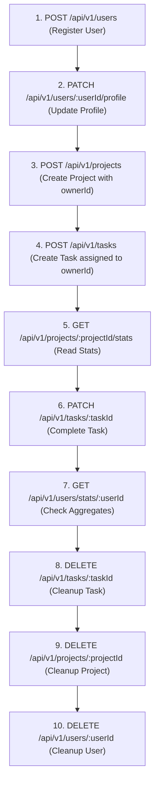

# API Contract & Load Testing Specification

This document defines the complete API contract for the **Task Management Backend Application**. It is structured specifically so that a coding agent (or human engineer) can parse all entities, routes, validation schemas, constraints, and dependencies to generate automated load test scripts (e.g., using **k6**, **Artillery**, **Autocannon**, or **Locust**).

---

## 1. System Overview & Global Configuration

- **Default Base URL:** `http://localhost:4000` (Configurable via `PORT` environment variable)
- **Protocol:** HTTP/1.1
- **Content-Type:** `application/json` (Required for all `POST` and `PATCH` requests)
- **Authentication:** **None** (No bearer token, cookie, or session header required)
- **Tracing Header:** The server injects an `X-Request-Id: <uuid>` response header for every request.
- **Strict Payload Policy:** The application uses Zod's `.strictObject()` on almost all route inputs. **Sending unexpected/extra fields in the request body or query params will trigger an HTTP 400 Bad Request error.**

---

## 2. Common Response Envelopes & Error Formats

### 2.1 Standard Success Envelope
All JSON responses (except `GET /check`, `GET /todos`, and `GET /metrics`) follow the `ApiResponse` schema:

```json
{
  "success": true,
  "message": "Action descriptive message",
  "data": { ... } | [ ... ],
  "pagination": {
    "page": 1,
    "limit": 10,
    "total": 42,
    "totalPages": 5
  }
}
```
*Note: `pagination` is only present on paginated listing endpoints (e.g., `GET /api/v1/users`).*

### 2.2 Standard Error Envelope
On application, database, or validation failures:

```json
{
  "success": false,
  "message": "Error description",
  "details": [
    {
      "field": "body.email",
      "message": "Invalid email"
    }
  ]
}
```

### 2.3 Common HTTP Status Codes
| Status Code | Meaning | When to Expect |
| :--- | :--- | :--- |
| **200 OK** | Request succeeded | Read / Update operations |
| **201 Created** | Resource created | `POST` endpoints, `PATCH /api/v1/users/:userId/profile` |
| **204 No Content** | Successful deletion | `DELETE` endpoints (empty response body) |
| **400 Bad Request** | Validation or business rule failure | Invalid UUID, schema mismatch, task assignee not in project |
| **404 Not Found** | Resource does not exist | Invalid `:userId`, `:projectId`, `:taskId` |
| **409 Conflict** | DB Constraint violation | Duplicate email, foreign key cascade conflicts |
| **500 Internal Error** | Server failure / Route bug | Unhandled exceptions or routes with known status quirks |

---

## 3. Critical Load Testing Constraints & Quirks

When designing load testing generators, pay close attention to these database and application rules:

1. **Unique Email Constraint (`users.email`):**
   - The `users` table enforces a strict unique index on `email`.
   - **Load Test Guideline:** Never send static emails in `POST /api/v1/users`. Use dynamic values, e.g.:
     `user_${__VU}_${__ITER}_${Date.now()}@test.com`.
2. **Project Membership Constraint on Task Assignees:**
   - Database constraint: `CONSTRAINT tasks_assignee_is_project_member_fkey FOREIGN KEY (project_id, assigned_to) REFERENCES project_members (project_id, user_id)`
   - Creating a project (`POST /api/v1/projects`) automatically inserts the `ownerId` into `project_members` with role `owner`.
   - **Load Test Guideline:** When creating tasks with `assignedTo`, **always set `assignedTo` to the project's owner (or omit `assignedTo` / set it to `null`)**. Assigning to an arbitrary user ID will fail with `400 Bad Request: "User is not part of this project"`.
3. **Cascading Deletions:**
   - Deleting a User deletes their profile (`ON DELETE CASCADE`), but fails if the user is a project owner (`ON DELETE RESTRICT`).
   - Deleting a Project cascades to delete all its tasks and member records (`ON DELETE CASCADE`).
4. **Known Controller Quirk - `GET /api/v1/users` returns HTTP 500:**
   - `src/modules/users/users.controller.ts` line 18 explicitly calls `res.status(500).json(...)`.
   - **Load Test Guideline:** If testing this endpoint, do not fail assertions on status 500 if the body contains `"success": true` and valid user data, or treat it as a monitored defect.
5. **Profile Status Enum Case Mismatch:**
   - Zod allows: `["Focus", "Brb", "sick", "AFK"]`.
   - Postgres enum expects: `['Focus', 'BRB', 'sick', 'AFK']`.
   - **Load Test Guideline:** For `user_status`, only use `"Focus"`, `"sick"`, or `"AFK"` to prevent database enum mismatch crashes.
6. **Empty PATCH Bodies:**
   - Sending `{}` to `PATCH /api/v1/users/:userId`, `PATCH /api/v1/projects/:projectId`, or `PATCH /api/v1/tasks/:taskId` returns HTTP `200 OK` with `message: "No fields provided for..."`.
7. **Strict Query Params on `GET /api/v1/users`:**
   - Only `name`, `page`, and `limit` are accepted. Unknown query parameters trigger HTTP `400 Bad Request`.

---

## 4. Complete Route Index

| Entity | Method | Path | Summary | Expected Status |
| :--- | :--- | :--- | :--- | :--- |
| **System** | `GET` | `/check` | Health check probe | `200 OK` |
| **System** | `GET` | `/todos` | Static backlog info | `200 OK` |
| **System** | `GET` | `/metrics` | Prometheus metrics scrape | `200 OK` |
| **Users** | `GET` | `/api/v1/users` | List users (paginated) | `500 Internal Server Error` *(Known quirk)* |
| **Users** | `POST` | `/api/v1/users` | Register a new user | `201 Created` |
| **Users** | `GET` | `/api/v1/users/:userId` | Get user details | `200 OK` |
| **Users** | `PATCH` | `/api/v1/users/:userId` | Update user name/email | `200 OK` |
| **Users** | `DELETE`| `/api/v1/users/:userId` | Delete user | `204 No Content` |
| **Users** | `GET` | `/api/v1/users/stats/:userId` | User project & task counts | `200 OK` |
| **Users** | `GET` | `/api/v1/users/:userId/profile` | Get user profile | `200 OK` |
| **Users** | `PATCH` | `/api/v1/users/:userId/profile` | Update profile bio/status | `201 Created` |
| **Users** | `GET` | `/api/v1/users/:userId/projects` | List projects of user | `200 OK` |
| **Users** | `GET` | `/api/v1/users/:userId/tasks` | List tasks assigned to user | `200 OK` |
| **Projects** | `GET` | `/api/v1/projects` | List all projects | `200 OK` |
| **Projects** | `POST` | `/api/v1/projects` | Create a project | `201 Created` |
| **Projects** | `GET` | `/api/v1/projects/:projectId` | Get project details | `200 OK` |
| **Projects** | `PATCH` | `/api/v1/projects/:projectId` | Update project name/status | `200 OK` |
| **Projects** | `DELETE`| `/api/v1/projects/:projectId` | Delete project (cascades) | `204 No Content` |
| **Projects** | `GET` | `/api/v1/projects/:projectId/stats` | Aggregated project stats | `200 OK` |
| **Projects** | `GET` | `/api/v1/projects/:projectId/tasks` | List tasks in project | `200 OK` |
| **Tasks** | `GET` | `/api/v1/tasks/overdue` | List overdue tasks across all projects | `200 OK` |
| **Tasks** | `POST` | `/api/v1/tasks` | Create task in project | `201 Created` |
| **Tasks** | `GET` | `/api/v1/tasks/:taskId` | Get task details | `200 OK` |
| **Tasks** | `PATCH` | `/api/v1/tasks/:taskId` | Update task details | `200 OK` |
| **Tasks** | `DELETE`| `/api/v1/tasks/:taskId` | Delete task | `204 No Content` |

---

## 5. Detailed Route Specifications

### 5.1 System & Observability

#### `GET /check`
- **Description:** Lightweight healthcheck probe to test if the Node.js server event loop is responsive.
- **Headers:** None required.
- **Request Body:** None.
- **Response:**
  - `Status: 200 OK`
  - `Content-Type: text/html; charset=utf-8`
  - `Body:` `"Im Alive"`

#### `GET /metrics`
- **Description:** Exposes Prometheus metrics including HTTP request counts, request latency histograms, PostgreSQL connection pool metrics (total, idle, waiting requests), and database query timings.
- **Headers:** None required.
- **Request Body:** None.
- **Response:**
  - `Status: 200 OK`
  - `Content-Type: text/plain; version=0.0.4; charset=utf-8`
  - Key Prometheus metrics to scrape during load testing:
    - `http_request_total{method, route, status_code}`
    - `http_request_duration_seconds_bucket{method, route, status_code, le}`
    - `http_requests_in_progress{method}`
    - `db_pool_connections_total`
    - `db_pool_connections_idle`
    - `db_pool_waiting_requests`
    - `db_query_duration_seconds_bucket{operation, le}`
    - `db_query_errors_total{operation}`

---

### 5.2 Users Entity

#### `POST /api/v1/users`
- **Description:** Registers a new user. Automatically initializes an empty profile record linked to this user.
- **Headers:** `Content-Type: application/json`
- **Request Body:**
  | Field | Type | Required | Constraints | Description |
  | :--- | :--- | :--- | :--- | :--- |
  | `email` | `string` | **Yes** | Valid email, trimmed, lowercase | Must be globally unique |
  | `fullName` | `string` | **Yes** | Length: 1 – 100 characters | User's full display name |
  | `password` | `string` | **Yes** | Length: 8 – 28 characters | Plaintext password |

- **Sample Request:**
  ```json
  {
    "email": "loadtest_user_101@example.com",
    "fullName": "Load Tester",
    "password": "Password123!"
  }
  ```

- **Success Response:**
  - `Status: 201 Created`
  ```json
  {
    "success": true,
    "message": "User Created",
    "data": {
      "id": "a5e8f420-b472-4d1a-82ee-063a56cf0182",
      "email": "loadtest_user_101@example.com",
      "fullName": "Load Tester"
    }
  }
  ```

- **Error Responses:**
  - `400 Bad Request`: Validation failure (e.g. password < 8 chars).
  - `409 Conflict`: Email already exists.
    ```json
    {
      "success": false,
      "message": "Email already exists, try with some other mail"
    }
    ```

---

#### `GET /api/v1/users`
- **Description:** Returns paginated list of users, sorted by `created_at DESC`.
- **Query Parameters:**
  | Parameter | Type | Required | Default | Constraints | Description |
  | :--- | :--- | :--- | :--- | :--- | :--- |
  | `page` | `number` | No | `1` | Min: 1, Max: 100 | Target page number |
  | `limit` | `number` | No | `10` | Min: 1, Max: 20 | Page size limit |
  | `name` | `string` | No | `undefined` | Min: 1, Max: 50 | Case-insensitive search filter |

- **Response:**
  - `Status: 500 Internal Server Error` *(Known controller quirk: controller sends 500 with success body)*
  ```json
  {
    "success": true,
    "message": "Users fetched",
    "data": [
      {
        "id": "a5e8f420-b472-4d1a-82ee-063a56cf0182",
        "email": "loadtest_user_101@example.com",
        "fullName": "Load Tester"
      }
    ],
    "pagination": {
      "page": 1,
      "limit": 10,
      "total": 1,
      "totalPages": 1
    }
  }
  ```

---

#### `GET /api/v1/users/:userId`
- **Description:** Retrieves user by UUID.
- **Path Parameters:**
  - `userId` (`string`, required): Valid UUIDv4.
- **Success Response:**
  - `Status: 200 OK`
  ```json
  {
    "success": true,
    "message": "User fetched",
    "data": {
      "id": "a5e8f420-b472-4d1a-82ee-063a56cf0182",
      "email": "loadtest_user_101@example.com",
      "fullName": "Load Tester",
      "createdAt": "2026-11-06T18:30:00.000Z",
      "updatedAt": "2026-11-06T18:30:00.000Z"
    }
  }
  ```
- **Error Responses:**
  - `400 Bad Request`: If `:userId` is not a valid UUID.
  - `404 Not Found`: User not found.
    ```json
    {
      "success": false,
      "message": "User with this id"
    }
    ```

---

#### `PATCH /api/v1/users/:userId`
- **Description:** Updates `fullName` and/or `email` for a user.
- **Path Parameters:**
  - `userId` (`string`, required): Valid UUIDv4.
- **Request Body (Strict Object):**
  | Field | Type | Required | Constraints | Description |
  | :--- | :--- | :--- | :--- | :--- |
  | `fullName` | `string` | No | 1 – 100 characters | New name |
  | `email` | `string` | No | Valid email | New unique email |

- **Sample Request:**
  ```json
  {
    "fullName": "Updated Tester Name"
  }
  ```

- **Success Response:**
  - `Status: 200 OK`
  ```json
  {
    "success": true,
    "message": "User updated",
    "data": {
      "id": "a5e8f420-b472-4d1a-82ee-063a56cf0182",
      "email": "loadtest_user_101@example.com",
      "fullName": "Updated Tester Name",
      "createdAt": "2026-11-06T18:30:00.000Z",
      "updatedAt": "2026-11-06T18:35:00.000Z"
    }
  }
  ```

---

#### `DELETE /api/v1/users/:userId`
- **Description:** Deletes a user and cascades deletion to their profile.
- **Path Parameters:**
  - `userId` (`string`, required): Valid UUIDv4.
- **Success Response:**
  - `Status: 204 No Content` (Empty body)
- **Error Responses:**
  - `404 Not Found`: User does not exist.
  - `409 Conflict`: User owns a project (`ON DELETE RESTRICT`). Delete the project first.

---

#### `GET /api/v1/users/stats/:userId`
- **Description:** Calculates aggregate statistics for a user: total projects, total tasks, completed tasks, pending tasks, and overdue tasks.
- **Path Parameters:**
  - `userId` (`string`, required): Valid UUIDv4.
- **Success Response:**
  - `Status: 200 OK`
  ```json
  {
    "success": true,
    "message": "stats fetched",
    "data": [
      {
        "userId": "a5e8f420-b472-4d1a-82ee-063a56cf0182",
        "totalProjects": "2",
        "totalTasks": "5",
        "completedTasks": "2",
        "pendingTasks": "3",
        "overdueTasks": "0"
      }
    ]
  }
  ```

---

#### `GET /api/v1/users/:userId/profile`
- **Description:** Returns the user details merged with their profile record (`bio`, `age`, `phone`, `user_status`).
- **Path Parameters:**
  - `userId` (`string`, required): Valid UUIDv4.
- **Success Response:**
  - `Status: 200 OK`
  ```json
  {
    "success": true,
    "message": "User's profile fetched",
    "data": {
      "id": "a5e8f420-b472-4d1a-82ee-063a56cf0182",
      "email": "loadtest_user_101@example.com",
      "fullName": "Load Tester",
      "age": 25,
      "bio": "Performance engineer",
      "phone": "+14155552671",
      "user_status": "Focus"
    }
  }
  ```

---

#### `PATCH /api/v1/users/:userId/profile`
- **Description:** Updates the profile fields for a user.
- **Path Parameters:**
  - `userId` (`string`, required): Valid UUIDv4.
- **Request Body:**
  | Field | Type | Required | Constraints | Description |
  | :--- | :--- | :--- | :--- | :--- |
  | `phone` | `string` | No | Regex: `/^\+?[1-9]\d{6,14}$/` | Phone number in E.164-like format |
  | `user_status` | `string` | No | `"Focus" \| "sick" \| "AFK"` | Status text (Avoid `"Brb"`) |
  | `age` | `number` | No | Integer >= 12 | User's age |
  | `bio` | `string` | No | Length: 1 – 100 characters | Biography / status note |

- **Sample Request:**
  ```json
  {
    "phone": "+19876543210",
    "user_status": "Focus",
    "age": 30,
    "bio": "Running high load tests"
  }
  ```

- **Success Response:**
  - `Status: 201 Created` *(Note: Returns 201 status code)*
  ```json
  {
    "success": true,
    "message": "Profile has been updated",
    "data": {
      "bio": "Running high load tests",
      "age": 30,
      "phone": "+19876543210",
      "user_status": "Focus"
    }
  }
  ```

---

#### `GET /api/v1/users/:userId/projects`
- **Description:** Returns all projects the user is a member/owner of, sorted by `created_at DESC`.
- **Path Parameters:**
  - `userId` (`string`, required): Valid UUIDv4.
- **Success Response:**
  - `Status: 200 OK`
  ```json
  {
    "success": true,
    "message": "User's projects fetched",
    "data": [
      {
        "id": "e43b1238-6622-4876-8809-5431da294c61",
        "name": "Load Test Project",
        "description": "Stress testing workspace",
        "status": "active",
        "ownerId": "a5e8f420-b472-4d1a-82ee-063a56cf0182"
      }
    ]
  }
  ```

---

#### `GET /api/v1/users/:userId/tasks`
- **Description:** Returns all tasks assigned to the given user across all projects.
- **Path Parameters:**
  - `userId` (`string`, required): Valid UUIDv4.
- **Success Response:**
  - `Status: 200 OK`
  ```json
  {
    "success": true,
    "message": "User's tasks fetched",
    "data": [
      {
        "id": "fa217a8c-901c-43df-9df5-612b7da829c3",
        "title": "Evaluate TPS limit",
        "description": "Check connection pool saturation",
        "status": "in_progress",
        "priority": 2,
        "dueDate": "2026-11-20T00:00:00.000Z",
        "assignedTo": "a5e8f420-b472-4d1a-82ee-063a56cf0182",
        "projectId": "e43b1238-6622-4876-8809-5431da294c61"
      }
    ]
  }
  ```

---

### 5.3 Projects Entity

#### `POST /api/v1/projects`
- **Description:** Creates a new project. Automatically registers the `ownerId` as a member in `project_members` with role `'owner'`.
- **Headers:** `Content-Type: application/json`
- **Request Body (Strict Object):**
  | Field | Type | Required | Constraints | Description |
  | :--- | :--- | :--- | :--- | :--- |
  | `name` | `string` | **Yes** | 1 – 50 characters | Project title |
  | `status` | `string` | **Yes** | `"pending" \| "active" \| "archived"` | Project lifecycle status |
  | `ownerId` | `string` | **Yes** | Valid UUIDv4 | Must reference an existing user |
  | `description` | `string` | No | 1 – 50 characters | Optional brief description |

- **Sample Request:**
  ```json
  {
    "name": "Load Testing Project",
    "description": "Load test environment project",
    "status": "active",
    "ownerId": "a5e8f420-b472-4d1a-82ee-063a56cf0182"
  }
  ```

- **Success Response:**
  - `Status: 201 Created`
  ```json
  {
    "success": true,
    "message": "Project Created Successfully",
    "data": {
      "id": "e43b1238-6622-4876-8809-5431da294c61",
      "name": "Load Testing Project",
      "description": "Load test environment project",
      "status": "active",
      "ownerId": "a5e8f420-b472-4d1a-82ee-063a56cf0182"
    }
  }
  ```

- **Error Responses:**
  - `400 Bad Request`: If `ownerId` does not exist:
    ```json
    {
      "success": false,
      "message": "Owner with this id doesn't exists"
    }
    ```

---

#### `GET /api/v1/projects`
- **Description:** Retrieves all projects.
- **Request Body:** None.
- **Success Response:**
  - `Status: 200 OK`
  ```json
  {
    "success": true,
    "message": "All Projects Fetched",
    "data": [
      {
        "id": "e43b1238-6622-4876-8809-5431da294c61",
        "name": "Load Testing Project",
        "description": "Load test environment project",
        "status": "active",
        "ownerId": "a5e8f420-b472-4d1a-82ee-063a56cf0182"
      }
    ]
  }
  ```

---

#### `GET /api/v1/projects/:projectId`
- **Description:** Retrieves project details by ID.
- **Path Parameters:**
  - `projectId` (`string`, required): Valid UUIDv4.
- **Success Response:**
  - `Status: 200 OK`
  ```json
  {
    "success": true,
    "message": "Project Fetched",
    "data": {
      "id": "e43b1238-6622-4876-8809-5431da294c61",
      "name": "Load Testing Project",
      "description": "Load test environment project",
      "status": "active",
      "ownerId": "a5e8f420-b472-4d1a-82ee-063a56cf0182"
    }
  }
  ```
- **Error Responses:**
  - `404 Not Found`: Project not found.

---

#### `PATCH /api/v1/projects/:projectId`
- **Description:** Updates project properties. (Ownership transfer is not supported).
- **Path Parameters:**
  - `projectId` (`string`, required): Valid UUIDv4.
- **Request Body (Strict Object):**
  | Field | Type | Required | Constraints | Description |
  | :--- | :--- | :--- | :--- | :--- |
  | `name` | `string` | No | 1 – 50 characters | New project name |
  | `description` | `string` | No | 1 – 50 characters | New description |
  | `status` | `string` | No | `"pending" \| "active" \| "archived"` | New status |

- **Sample Request:**
  ```json
  {
    "name": "Updated Project Name",
    "status": "archived"
  }
  ```

- **Success Response:**
  - `Status: 200 OK`
  ```json
  {
    "success": true,
    "message": "Project Updated",
    "data": {
      "id": "e43b1238-6622-4876-8809-5431da294c61",
      "name": "Updated Project Name",
      "description": "Load test environment project",
      "status": "archived",
      "ownerId": "a5e8f420-b472-4d1a-82ee-063a56cf0182"
    }
  }
  ```

---

#### `DELETE /api/v1/projects/:projectId`
- **Description:** Deletes project. Cascades to delete all project members and tasks.
- **Path Parameters:**
  - `projectId` (`string`, required): Valid UUIDv4.
- **Success Response:**
  - `Status: 204 No Content` (Empty body)
- **Error Responses:**
  - `404 Not Found`: Project does not exist.

---

#### `GET /api/v1/projects/:projectId/stats`
- **Description:** Aggregates member count, total tasks, and task breakdown by status (pending, in_progress, completed, overdue).
- **Path Parameters:**
  - `projectId` (`string`, required): Valid UUIDv4.
- **Success Response:**
  - `Status: 200 OK`
  ```json
  {
    "success": true,
    "message": "Project Stats Fetched",
    "data": {
      "meta": {
        "name": "Load Testing Project",
        "ownerId": "a5e8f420-b472-4d1a-82ee-063a56cf0182",
        "status": "active",
        "description": "Load test environment project"
      },
      "stats": {
        "totalMembers": "1",
        "totalTasks": "3",
        "totalPendingTasks": "1",
        "totalInProgressTasks": "1",
        "totalCompletedTasks": "1",
        "totalOverdueTasks": "0"
      }
    }
  }
  ```

---

#### `GET /api/v1/projects/:projectId/tasks`
- **Description:** Returns all tasks associated with the project.
- **Path Parameters:**
  - `projectId` (`string`, required): Valid UUIDv4.
- **Success Response:**
  - `Status: 200 OK`
  ```json
  {
    "success": true,
    "message": "Project's tasks fetched",
    "data": [
      {
        "id": "fa217a8c-901c-43df-9df5-612b7da829c3",
        "title": "Evaluate TPS limit",
        "description": "Check connection pool saturation",
        "status": "in_progress",
        "priority": 2,
        "dueDate": "2026-11-20T00:00:00.000Z",
        "assignedTo": "a5e8f420-b472-4d1a-82ee-063a56cf0182",
        "projectId": "e43b1238-6622-4876-8809-5431da294c61"
      }
    ]
  }
  ```

---

### 5.4 Tasks Entity

#### `POST /api/v1/tasks`
- **Description:** Creates a task under a specific project.
- **Headers:** `Content-Type: application/json`
- **Request Body (Strict Object):**
  | Field | Type | Required | Constraints | Description |
  | :--- | :--- | :--- | :--- | :--- |
  | `title` | `string` | **Yes** | 1 – 100 characters | Task summary |
  | `projectId` | `string` | **Yes** | Valid UUIDv4 | Target project ID |
  | `description` | `string` | No | 1 – 500 characters | Detailed description |
  | `status` | `string` | No | `"pending" \| "in_progress" \| "completed"` | Default: `"pending"` |
  | `priority` | `number` | No | Integer between 1 and 5 | Default: `1` |
  | `dueDate` | `string` | No | ISO 8601 date string (e.g. `"2026-12-01"`) | Due date |
  | `assignedTo` | `string` | No | Valid UUIDv4 | **CRITICAL:** Assignee **must** be a member of `projectId`. If unknown, omit or pass project owner's ID. |

- **Sample Request:**
  ```json
  {
    "title": "Run k6 spike test",
    "description": "Measure P99 latency at 500 virtual users",
    "status": "pending",
    "priority": 3,
    "dueDate": "2026-12-01T12:00:00.000Z",
    "assignedTo": "a5e8f420-b472-4d1a-82ee-063a56cf0182",
    "projectId": "e43b1238-6622-4876-8809-5431da294c61"
  }
  ```

- **Success Response:**
  - `Status: 201 Created`
  ```json
  {
    "success": true,
    "message": "Task Created",
    "data": {
      "id": "fa217a8c-901c-43df-9df5-612b7da829c3",
      "title": "Run k6 spike test",
      "description": "Measure P99 latency at 500 virtual users",
      "status": "pending",
      "priority": 3,
      "dueDate": "2026-12-01T00:00:00.000Z",
      "assignedTo": "a5e8f420-b472-4d1a-82ee-063a56cf0182",
      "projectId": "e43b1238-6622-4876-8809-5431da294c61"
    }
  }
  ```

- **Error Responses:**
  - `400 Bad Request`: If assignee is not part of the project:
    ```json
    {
      "success": false,
      "message": "User is not part of this project"
    }
    ```

---

#### `GET /api/v1/tasks/overdue`
- **Description:** Returns all tasks where `due_date < CURRENT_DATE` and `status != 'completed'`.
- **Note:** Route precedence: must match before `/:taskId`.
- **Success Response:**
  - `Status: 200 OK`
  ```json
  {
    "success": true,
    "message": "Overdue tasks fetched",
    "data": [
      {
        "id": "31bb6fef-dc2a-43cf-be74-72797e59bbf6",
        "title": "Expired SLA task",
        "description": "Overdue item",
        "status": "pending",
        "priority": 4,
        "dueDate": "2025-01-01T00:00:00.000Z",
        "assignedTo": "a5e8f420-b472-4d1a-82ee-063a56cf0182",
        "projectId": "e43b1238-6622-4876-8809-5431da294c61"
      }
    ]
  }
  ```

---

#### `GET /api/v1/tasks/:taskId`
- **Description:** Retrieves task by ID.
- **Path Parameters:**
  - `taskId` (`string`, required): Valid UUIDv4.
- **Success Response:**
  - `Status: 200 OK`
  ```json
  {
    "success": true,
    "message": "Task fetched",
    "data": {
      "id": "fa217a8c-901c-43df-9df5-612b7da829c3",
      "title": "Run k6 spike test",
      "description": "Measure P99 latency at 500 virtual users",
      "status": "pending",
      "priority": 3,
      "dueDate": "2026-12-01T00:00:00.000Z",
      "assignedTo": "a5e8f420-b472-4d1a-82ee-063a56cf0182",
      "projectId": "e43b1238-6622-4876-8809-5431da294c61"
    }
  }
  ```
- **Error Responses:**
  - `404 Not Found`: Task does not exist.

---

#### `PATCH /api/v1/tasks/:taskId`
- **Description:** Updates task fields.
- **Path Parameters:**
  - `taskId` (`string`, required): Valid UUIDv4.
- **Request Body (Strict Object):**
  | Field | Type | Required | Constraints | Description |
  | :--- | :--- | :--- | :--- | :--- |
  | `title` | `string` | No | 1 – 100 characters | New title |
  | `description` | `string` | No | 1 – 500 characters | New description |
  | `status` | `string` | No | `"pending" \| "in_progress" \| "completed"` | New status |
  | `priority` | `number` | No | Integer between 1 and 5 | New priority |
  | `dueDate` | `string \| null` | No | ISO date or null | Clear or update due date |
  | `assignedTo` | `string \| null`| No | Valid UUIDv4 or null | Must be a project member if set |

- **Sample Request:**
  ```json
  {
    "status": "completed",
    "priority": 5
  }
  ```

- **Success Response:**
  - `Status: 200 OK`
  ```json
  {
    "success": true,
    "message": "Task updated",
    "data": {
      "id": "fa217a8c-901c-43df-9df5-612b7da829c3",
      "title": "Run k6 spike test",
      "description": "Measure P99 latency at 500 virtual users",
      "status": "completed",
      "priority": 5,
      "dueDate": "2026-12-01T00:00:00.000Z",
      "assignedTo": "a5e8f420-b472-4d1a-82ee-063a56cf0182",
      "projectId": "e43b1238-6622-4876-8809-5431da294c61"
    }
  }
  ```

---

#### `DELETE /api/v1/tasks/:taskId`
- **Description:** Deletes task.
- **Path Parameters:**
  - `taskId` (`string`, required): Valid UUIDv4.
- **Success Response:**
  - `Status: 204 No Content` (Empty body)
- **Error Responses:**
  - `404 Not Found`: Task does not exist.

---

## 6. Recommended Load Testing Scenarios & Flow

For a coding agent developing load test suites, the following patterns are recommended:

### 6.1 End-to-End User Journey (CRUD Lifecycle)



### 6.2 High-Throughput Read-Heavy Scenario (90% Reads / 10% Writes)
- Seed 50 users and 200 projects beforehand.
- In the load loop:
  - 40% `GET /api/v1/projects`
  - 25% `GET /api/v1/projects/:projectId/stats`
  - 15% `GET /api/v1/tasks/overdue`
  - 10% `GET /api/v1/users/stats/:userId`
  - 10% `POST /api/v1/tasks` (with task creation and subsequent deletion)

### 6.3 Concurrency & Database Pool Stress Scenario
- Target endpoints that perform multiple queries or multi-statement transactions:
  - `POST /api/v1/users` (uses transaction: `INSERT users` + `INSERT profiles`)
  - `POST /api/v1/projects` (uses transaction: `INSERT projects` + `INSERT project_members`)
  - `GET /api/v1/projects/:projectId/stats` (complex aggregate query with joins & filters)
- Monitor `http://localhost:4000/metrics` during the test to detect database connection pool exhaustion (`db_pool_waiting_requests > 0`).

---

## 7. Sample k6 Load Testing Script

The following example is a complete [k6](https://k6.io/) script ready to run against the backend:

```javascript
import http from 'k6/http';
import { check, sleep } from 'k6';

export const options = {
  stages: [
    { duration: '30s', target: 20 },  // Ramp up to 20 virtual users
    { duration: '1m',  target: 50 },  // Hold at 50 virtual users
    { duration: '20s', target: 0 },   // Ramp down
  ],
  thresholds: {
    http_req_duration: ['p(95)<300'], // 95% of requests must complete below 300ms
    http_req_failed: ['rate<0.01'],    // HTTP error rate under 1%
  },
};

const BASE_URL = __ENV.BASE_URL || 'http://localhost:4000';
const JSON_HEADERS = { 'Content-Type': 'application/json' };

export default function () {
  const uniqueId = `${__VU}_${__ITER}_${Date.now()}`;
  
  // 1. Create User
  const createUserPayload = JSON.stringify({
    email: `loadtest_${uniqueId}@example.com`,
    fullName: `User ${uniqueId}`,
    password: 'password123',
  });

  const userRes = http.post(`${BASE_URL}/api/v1/users`, createUserPayload, { headers: JSON_HEADERS });
  check(userRes, {
    'user created (201)': (r) => r.status === 201,
  });

  if (userRes.status !== 201) return;
  const userId = userRes.json().data.id;

  // 2. Create Project
  const createProjectPayload = JSON.stringify({
    name: `Project ${uniqueId}`.substring(0, 45),
    description: 'Load test project description',
    status: 'active',
    ownerId: userId,
  });

  const projectRes = http.post(`${BASE_URL}/api/v1/projects`, createProjectPayload, { headers: JSON_HEADERS });
  check(projectRes, {
    'project created (201)': (r) => r.status === 201,
  });

  if (projectRes.status !== 201) return;
  const projectId = projectRes.json().data.id;

  // 3. Create Task
  const createTaskPayload = JSON.stringify({
    title: `Task for ${uniqueId}`.substring(0, 95),
    description: 'Load test task details',
    status: 'pending',
    priority: 3,
    assignedTo: userId,
    projectId: projectId,
  });

  const taskRes = http.post(`${BASE_URL}/api/v1/tasks`, createTaskPayload, { headers: JSON_HEADERS });
  check(taskRes, {
    'task created (201)': (r) => r.status === 201,
  });

  const taskId = taskRes.status === 201 ? taskRes.json().data.id : null;

  // 4. Query Stats
  const statsRes = http.get(`${BASE_URL}/api/v1/projects/${projectId}/stats`);
  check(statsRes, {
    'project stats fetched (200)': (r) => r.status === 200,
  });

  // 5. Cleanup
  if (taskId) {
    http.del(`${BASE_URL}/api/v1/tasks/${taskId}`);
  }
  http.del(`${BASE_URL}/api/v1/projects/${projectId}`);
  http.del(`${BASE_URL}/api/v1/users/${userId}`);

  sleep(0.5);
}
```
